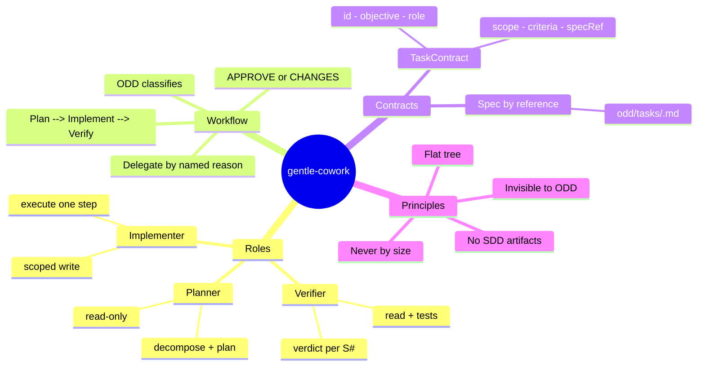
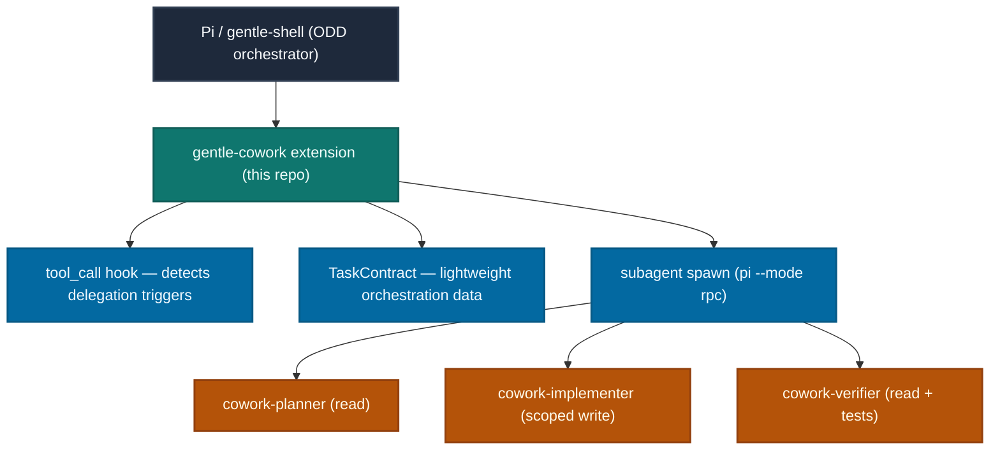

# gentle-cowork

Multi-role orchestration extension for [Pi](https://pi.dev) / [gentle-shell](https://github.com/Gentleman-Programming/gentle-pi) that turns ODD-approved delegation into a structured, verified, multi-role workflow — without ever becoming a silent SDD.

[](https://www.typescriptlang.org/)
[](https://nodejs.org/)
[](https://vitest.dev/)
[](https://pi.dev)
[](https://conventionalcommits.org/)
[](https://github.com/features/actions)
[](https://linear.app)
[](LICENSE)

---

## About

**gentle-cowork** is the multi-node orchestration extension for the **gentle-pi / gentle-shell** ecosystem. It turns Organic Driven Development (ODD) delegation decisions into a structured, verified, multi-role workflow — without ever becoming a silent spec-driven development (SDD) framework.

### Current Version: **1.2.2** (2026-11-12)

### Why this exists

Most AI coding agents delegate by size or complexity. **gentle-cowork delegates by named reason only** — when ODD has already determined that:
- Real parallelism exists (independent units of work)
- Independent verification is required (high-risk changes)
- Context backstop was hit (~150k tokens)

The extension provides three specialized roles that operate on a shared **blackboard** with file locking, cryptographic lease fencing, and version-counter conflict resolution:

| Role | Permission | Responsibility |
|---|---|---|
| 🧠 **cowork-planner** | read-only | Decompose objective into plan with scope + acceptance criteria |
| 🔨 **cowork-implementer** | scoped write | Execute one plan step; produce artifact summary |
| ✅ **cowork-verifier** | read + tests | Validate per ODD spec requirement (S#) via native gentle-shell review (`review.start`/`review.finalize`, lenses `review-readability` + `review-reliability`); emit `APPROVE` or `CHANGES` |

### What makes it different

- **Never by size** — Delegation triggers only on named reasons (real parallelism, independent verification, context backstop)
- **Spec by reference** — Subagents receive the path to the ODD feature document, never a paraphrased summary
- **Lightweight contracts** — Each delegation carries a `TaskContract` (id, objective, role, scope, acceptanceCriteria, specRef) — no formal proposal/spec/design documents
- **Flat tree** — Subagents never spawn sub-subagents
- **Invisible to ODD** — User describes what they need; extension routes naturally; no `/cowork` invocation required
- **Native integration** — Uses gentle-pi 4.7 primitives (background jobs, fallback chains, command guards, Herdr state, TUI riel, WS transport, crypto) instead of reimplementing infrastructure

### Status

| Phase | Status | Description |
|---|---|---|
| **Phase 0** | ✅ | Project skeleton, TaskContract, role definitions |
| **Phase 1** | ✅ | Verifier spawn via `pi --mode rpc` |
| **Phase 2** | ✅ | Full orchestration chain + **Native Review Integration** (review.start/finalize, lenses review-readability + review-reliability) |
| **Phase 3** | ✅ | Invisible delegation via tool_call hook |
| **Phase 4** | ✅ | Blackboard state persistence (pending → in_progress → completed/failed) |
| **Phase 5 (local)** | ✅ | Multi-node local (sessions on same machine, blackboard + WS transport) |
| **Phase 5 (remote)** | 🏗️ | Multi-node remote (SSH tunnels, Docker workers, operator CLI) |
| **Phase 6-8** | 📋 | Enterprise roadmap (business layer, architectural memory, smart profiles) |

---

## Mental Map



## What it does

`gentle-cowork` adds three specialized subagent roles on top of gentle-shell's existing delegation mechanism:

| Role | Permission | Responsibility |
|---|---|---|
| 🧠 **cowork-planner** | read-only | Decompose the objective into a plan with scope and acceptance criteria |
| 🔨 **cowork-implementer** | scoped write | Execute one plan step; produces an artifact summary |
| ✅ **cowork-verifier** | read + tests | Validate changes per ODD spec requirement (S#) via native `gentle-shell` review (`review.start`/`review.finalize`, lenses `review-readability` + `review-reliability`); emit `APPROVE` or `CHANGES` verdict |

**The intelligence stays agent-side.** The bridge/extension only routes — every delegation sends a pre-crafted prompt to the assistant, which uses its native tools.

---

## Design principles

1. **Delegate by named reason, never by size.** Activated when ODD already determined that delegation has a valid reason (real parallelism, independent verification, context backstop) — never because a task "looks big".
2. **Pass the spec by reference.** Subagents receive the path to the ODD feature document, never a paraphrased summary.
3. **Lightweight task contract, not SDD artifacts.** Each delegation carries a `TaskContract` (`{ id, objective, role, scope, acceptanceCriteria, specRef, artifacts, status }`) — no formal proposal/spec/design documents.
4. **Flat delegation tree.** Subagents never spawn sub-subagents.
5. **Invisible to ODD.** The user describes what they need; the extension routes naturally. No `/cowork` invocation required for normal flows.

---

## Architecture



---

## Architectural Decision: gentle-cowork as Domain Layer on Native Platform

> **Decision:** gentle-cowork is a **domain layer** built on top of the native gentle-pi 4.7 platform. We do **not** reimplement infrastructure; we use the platform's native primitives and focus entirely on the orchestration domain.

### What is Native (Infrastructure — provided by gentle-pi 4.7)

| Capability | Native Implementation | gentle-cowork Usage |
|---|---|---|
| **Background Jobs** | `bash_background` tool, job registry, monitor tool | Dogfood runner (`/cowork-dogfood`), future remote worker supervision |
| **Model Fallback Chains** | `profile-fallbacks.json`, automatic failover per agent | PR-Agent reviewer (`nemotron-3-ultra` → `nemotron-3-super`), verifier, orchestrator |
| **Command Guards** | Native command guard policies (once/session/always/deny) | `/cowork-*` commands with `confirm` policy |
| **Herdr State File** | `~/.herdr/sessions/<session-id>.json` per session | Master/worker lifecycle state export (PI-T3) |
| **TUI Riel** | Native sidebar/rail integration point | Blackboard dashboard skill (`gentle-cowork-tui`, PI-T5) |
| **WebSocket Transport** | Native WS server (`src/ws/server.ts`), mTLS hooks | Multi-node transport (Phase 5) |
| **Blackboard Persistence** | Atomic JSON with file locking, version counter | Contract state, lease/fence, budget/metering |
| **Crypto Primitives** | `generateFence`, `generateNonce`, `isTimestampFresh` | Lease fencing, replay protection, ODD contracts |

### What is gentle-cowork (Domain Layer)

| Domain | Responsibility |
|---|---|
| **Blackboard Contracts** | `TaskContract` lifecycle, status transitions, history, version counter |
| **Budget & Metering** | `UsageSample`/`UsageLedger`, `evaluateGuards`, `meteredStepExecutor` |
| **Budget Guards** | `evaluateGuards` with ok/warning/exceeded/unknown, pause+escalate |
| **ODD Contracts** | `TaskContract` with `specRef`, acceptance criteria, version counter |
| **Oracle (Metering + Guards)** | `meteredStepExecutor`, `evaluateGuards`, master enforcement |
| **Role Orchestration** | Planner → Implementer → Verifier chain, CHANGES retry loop |
| **Verification** | `cowork-verifier` with per-S# verdict, blackboard persistence; native review integration via `gentle-shell` (`review.start`/`review.finalize`, lenses `review-readability` + `review-reliability`) |
| **Delegation Hook** | `tool_call` interception → role orchestration instead of native delegation |
| **Blackboard Persistence** | Contract state, leases, fences, budget/metering in versioned JSON |
| **WebSocket Protocol** | Message types, framing, lease/fence discipline |

### Decision Rationale

1. **Don't rebuild infra.** gentle-pi 4.7 provides battle-tested primitives (background jobs, fallback chains, command guards, Herdr, TUI riel, WS transport, crypto). Reimplementing them would duplicate effort and increase maintenance burden.

2. **Double down on domain.** The unique value of gentle-cowork is the *orchestration logic*: ODD contracts, role chains, budget guards, metering, verification verdicts, blackboard contract lifecycle. This is where we invest.

3. **Clean separation.** Native infra is stable, versioned, and shared across all extensions. Domain logic evolves with our ODD workflow and can be tested independently.

4. **Portability.** If gentle-pi evolves its primitives, we migrate the integration points — not the domain logic.

4. **No SDD artifacts.** We don't generate formal specs/design docs for the platform; we consume its native APIs. Our ODD contracts live in `odd/tasks/` and drive the domain.

### Migration Status (Platform Integration v4.7)

| PI Task | Status | Notes |
|---|---|---|
| PI-T1: Dogfood → native background jobs | ✅ Done | `bash_background`, removed `run-dogfood.sh` |
| PI-T2: Native command guards | ✅ Done | `.pi/gentle-ai/runtime-guardrails.json` with `confirm` for all `/cowork-*` commands |
| PI-T3: Herdr state export | ✅ Done | `src/herdr-state.ts`, `src/herdr-integration.ts` wired to MasterOrchestrator & LocalWorker (opt-in via `herdr: true`) |
| PI-T4: Native fallback chains | ✅ Done | `profile-fallbacks.json` + PR-Agent `fallback_models` |
| PI-T5: TUI dashboard skill | ✅ Done | `design/blackboard-dashboard/`, `src/dashboard.ts` |
| PI-T6: Architectural docs | ✅ This section | Decision documented |

---

## Commands Reference

The extension registers **5 commands** in the Pi session:

| Command | Alias | Description | Phase |
|---|---|---|---|
| `/cowork` | — | Show orchestration status (last contract, role, status) | 0 |
| `/cowork-contract` | — | Show the last TaskContract as JSON | 0 |
| `/cowork-verify` | — | Spawn cowork-verifier subagent (Phase 1 test) | 1 |
| `/cowork-chain` | — | Run full planner → implementer → verifier chain | 2 |
| `/cowork-dogfood` | — | Run dogfooding natively via Pi background jobs | 5 |

### Dogfood subcommands

```bash
/cowork-dogfood run [--timeout 300]     # Master + worker via bash_background (default 300s)
/cowork-dogfood master --shared-dir PATH # Master only
/cowork-dogfood worker --shared-dir PATH # Worker only
/cowork-dogfood help                     # Show usage
```

---

## ODD Integration

The extension is designed around **Organic Driven Development (ODD)**:

### Spec by Reference
Every delegation carries a `specRef` pointing to an ODD task document under `odd/tasks/<feature>.md`. The document structure:
```
odd/tasks/<feature>.md
├── ## Specs (S1, S2, S3...) — numbered requirements quoting user's exact words
├── ## Tasks (T1, T2, T3...) — one line per task: ID, linked S#, route, commit
└── ## Log (L1, L2, L3...) — original request verbatim + corrections, evidence, decisions
```

### Delegation Triggers (named reasons only)
The `tool_call` hook intercepts delegations **only when ODD has already classified a valid reason**:
1. **Real parallelism** — 2+ independent units of work (~100+ lines each, launched together)
2. **Independent verification** — High-risk item requiring `gentle-ai-verify` (data, security, contracts, concurrency, delivery, no-net)
3. **Context backstop** — Session hit ~150k tokens, delegate next unit

Without a named reason (`reason` field in tool input), **native delegation proceeds untouched**.

### Verification via Native Review
The `cowork-verifier` uses **gentle-shell native review integration**:
- `review.start` with lenses `review-readability` (S1 primary) + `review-reliability` (S2 primary)
- `review.finalize` via `captureResult` + `acknowledgeApproved`
- Per-S# verdict: `pass` / `fail` / `untested`
- Outcome: `APPROVE` or `CHANGES` (triggers retry loop, max 3)

### Contract Persistence (Phase 4)
Every `TaskContract` transition is persisted to the shared blackboard (`.gentle-cowork/blackboard.json`):
- Atomic JSON with file locking (`.lock` + random suffix)
- Version counter for optimistic concurrency
- Lease/fence with cryptographic tokens (`generateFence`)
- Survives daemon restarts (`session_start` reloads)

---

## The three roles

| Role | Permission | Responsibility |
|---|---|---|
| 🧠 **cowork-planner** | read-only | Decompose the objective into a plan with scope and acceptance criteria |
| 🔨 **cowork-implementer** | scoped write | Execute one plan step; produces an artifact summary |
| ✅ **cowork-verifier** | read + tests | Validate changes per ODD spec requirement (S#) via native `gentle-shell` review (`review.start`/`review.finalize`, lenses `review-readability` + `review-reliability`); emit `APPROVE` or `CHANGES` verdict |

---

## Pipeline — nothing merges unless GREEN

| Check | Workflow | Purpose |
|:---|:---|:---|
| `validate-conventional-commits / validate` | `validate-conventional-commits.yml` | Conventional Commits contract |
| `CodeQL / analyze` | `codeql.yml` | Security scanning (the Actions job, not the stale code-scanning context) |
| `PR Agent (NVIDIA Nemotron) / pr_agent_job` | `pr-agent-nvidia.yml` | Runs typecheck + tests + Nemotron-3-Ultra review |

**All three must be GREEN.** `enforce_admins: false` — you keep the admin merge bypass; agents cannot bypass. Ruleset requires conversation resolution.

---

## Prerequisites

- **Node.js ≥ 24** (pure ESM)
- **pnpm** (or npm) as package manager
- **Pi / gentle-shell ≥ 1.5.0** — this is an extension, not a standalone tool
- **Git**
- For multi-node (Phase 5): two or more Pi sessions on the same machine

---

## Installation

```bash
# 1. Clone and install dependencies
git clone https://github.com/ipproyectosysoluciones/gentle-cowork.git
cd gentle-cowork
pnpm install          # or: npm install

# 2. Configure your API keys / models (choose yours)
cp .env.example .env  # then edit .env with your keys
# OPENAI_API_KEY=sk-...
# ANTHROPIC_API_KEY=sk-ant-...
# NVIDIA_API_KEY=nvapi-...
# OLLAMA_BASE_URL=http://localhost:11434

# 3. Sanity check — both gates must be green
npx tsc --noEmit      # strict TypeScript, zero errors
npx vitest run        # 321 tests pass

# 4. Load it into your Pi session
pi -e ./src/gentle-cowork.ts
```

Or install permanently in your agent extensions folder:

```bash
cp src/gentle-cowork.ts ~/.pi/agent/extensions/gentle-cowork.ts
```

---

## Usage

The extension registers `/cowork` as a manual trigger. For automatic delegation, the `tool_call` hook detects when gentle-shell is about to delegate and applies the role orchestration based on the named delegation reason.

### Quick Start

```bash
# Start a Pi session with the extension loaded
pi -e ./src/gentle-cowork.ts

# In the Pi session, check status
/cowork

# Run a verification test (Phase 1)
/cowork-verify

# Run the full chain (Phase 2)
/cowork-chain
```

### Multi-node Dogfooding (Phase 5 local)

Two Pi sessions on the same machine coordinate through the shared blackboard:

```bash
# Terminal 1: Master
npm run dogfood:master -- --shared-dir /tmp/cowork-shared

# Terminal 2: Worker (in another Pi session)
npm run dogfood:worker -- --shared-dir /tmp/cowork-shared

# Or run both via native background jobs (single command)
npm run dogfood:run
```

### Remote Worker (Phase 5 remote — in progress)

Run a worker on a remote VPS (Docker container over SSH reverse tunnel):

```bash
npm run worker:remote -- --host <vps-host> --user <vps-user> \
  [--key <ssh-key-path>] --token <allowlist-token> \
  --env OPENAI_API_KEY=... --expected-node <worker-node-id>
```

The launcher provisions the VPS (installs Docker, writes `/etc/gentle-cowork/worker.env` mode 0600, starts the worker container with `--restart unless-stopped`), opens the SSH reverse tunnel to the master's WS port, and verifies the worker's registration on the blackboard.

---

## Zero-Trust Security (T5.7)

The multi-node transport includes a zero-trust layer:

| Layer | Feature | Status |
|---|---|---|
| **C1** | mTLS with x509 certificates | ✅ |
| **C3** | Message size limits | ✅ |
| **C5** | JSON depth limit | ✅ |
| **C6** | wss:// TLS config | ✅ |
| **C7** | Rate limiting | ✅ |
| **C9** | Inbound message text length limits | ✅ |
| **L1** | Security headers on Admin API | ✅ |
| **L2** | Audit log for admin mutating actions | ✅ |
| **L3** | Application-level ping/pong | ✅ |
| **M1** | Rate limiting for admin mutating endpoints | ✅ |
| **M3** | Explicit inbound message text length limits | ✅ |

Admin API endpoints (mutating): `/api/admin/allowlist`, `/api/admin/pair/start`, `/api/admin/pair/regenerate`, `/api/admin/pair/cancel`, `/api/admin/verify`, `/api/admin/unpair`

---

## Notes (read before using)

- **Not a standalone binary.** The extension only routes; the intelligence stays in your Pi/gentle-shell session. Without the host agent it does nothing.
- **Multi-node maturity.** Local stage complete: sessions on the same machine coordinate through `.gentle-cowork/blackboard.json` with file locking, leases with cryptographic fencing tokens, and version-counter conflict merge. The WebSocket transport (port `4318`, configurable, bound to `127.0.0.1`) — **TLS/mTLS is implemented (C1, C6); do not expose the port publicly without proper certs**.
- **Verifier authority.** The `cowork-verifier` role only ever runs on the master session — workers never verify, they execute.
- **Workers are subprocesses.** A worker is a `pi --mode rpc` child process that inherits the model configuration of the session that spawned it.
- **Quality gates.** Strict TypeScript (`no any`), full suite and typecheck green before every PR — the same contract the extension enforces on the agents it orchestrates.

---

## Contributing

Contributions follow the gentle-ecosystem contracts — the full rules live in [`.github/CONTRIBUTING.md`](.github/CONTRIBUTING.md):

- **Linear-first:** work is tracked in Linear (team `BLA`, project *gentle-cowork*); every PR references its issue as `BLA-N`, and evidence-first GitHub issue templates are the entry point for community reports.
- **Branch model:** `main` is the protected stable branch; feature branches (`feat|fix/<linear-issue>-<short>`) are cut from `dev`, and PRs target `dev`. Releases flow `dev` → `main` through an automated release PR.
- **Conventional Commits** in work-unit slices (~400 authored lines), with chained PRs for anything larger. The suite (`npx vitest run`) must be green and `npx tsc --noEmit` clean — strict TypeScript, no `any` ever — before every PR.

---

## Versioning

This project follows [Semantic Versioning](https://semver.org/spec/v2.0.0/). Versions are automated by [release-please](https://github.com/googleapis/release-please) from Conventional Commits: `feat` → minor, `fix` → patch, breaking changes (`!` / `BREAKING CHANGE:` footer) → major, and `docs`/`chore` never trigger a release. Human-readable history lives in [`CHANGELOG.md`](CHANGELOG.md).

---

## License

Released under the [MIT License](LICENSE) — Copyright © 2026 Bladimir Parra.

---

## Links

- **Repo:** https://github.com/ipproyectosysoluciones/gentle-cowork
- **Roadmap:** [ROADMAP.md](ROADMAP.md)
- **Contributing:** [`.github/CONTRIBUTING.md`](.github/CONTRIBUTING.md)
- **Gentle-AI:** https://github.com/Gentleman-Programming/gentle-ai