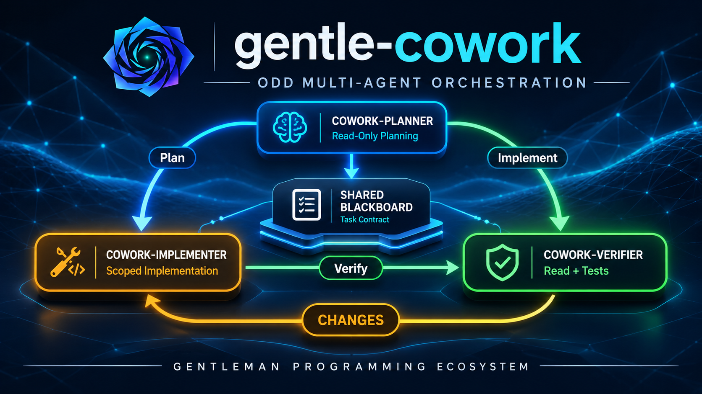

<!-- markdownlint-disable-next-line MD041 -->
<a id="top"></a>

<div align="center">



<h1>gentle-cowork</h1>

<p><strong>Multi-role orchestration extension for <a href="https://pi.dev">Pi</a> / <a href="https://github.com/Gentleman-Programming/gentle-pi">gentle-shell</a> that turns ODD-approved delegation into a structured, verified, multi-role workflow — without ever becoming a silent SDD.</strong></p>

<p>
<a href="https://github.com/ipproyectosysoluciones/gentle-cowork/actions/workflows/validate-conventional-commits.yml"></a>
<a href="https://nodejs.org/"></a>
<a href="https://vitest.dev/"></a>
<a href="https://pi.dev"></a>
<a href="https://conventionalcommits.org/"></a>
<a href="https://github.com/features/actions"></a>
<a href="https://linear.app"></a>
<a href="LICENSE"></a>
</p>

<p>
<a href="https://github.com/ipproyectosysoluciones/gentle-cowork"><strong>Repo</strong></a> &bull;
<a href="ROADMAP.md"><strong>Roadmap</strong></a> &bull;
<a href=".github/CONTRIBUTING.md"><strong>Contributing</strong></a> &bull;
<a href="https://github.com/Gentleman-Programming/gentle-ai"><strong>Gentle-AI</strong></a>
</p>

<br/>

<div align="center"></div>

## The idea in one paragraph

Assistants live in a browser tab you have to go find, forget you between chats, and stop at the edge of the page.
**gentle-cowork adds three specialized subagent roles on top of gentle-shell's existing delegation mechanism — turning one delegation into a structured, verified Plan → Implement → Verify cycle, without ever becoming a silent SDD.**

<br/>

<div align="center"></div>

## The three roles

| Role | Permission | Responsibility |
|:---|:---|:---|
| 🧠 **cowork-planner** | read-only | Decompose the objective into a plan with scope and acceptance criteria |
| 🔨 **cowork-implementer** | scoped write | Execute one plan step; produces an artifact summary |
| ✅ **cowork-verifier** | read + tests | Validate changes per ODD spec requirement (S#); emit `APPROVE` or `CHANGES` verdict |

**The intelligence stays agent-side.** The bridge/extension only routes — every delegation sends a pre-crafted prompt to the assistant, which uses its native tools.

<div align="center"></div>

## Design principles

1. **Delegate by named reason, never by size.** Activated when ODD already determined that delegation has a valid reason (real parallelism, independent verification, context backstop) — never because a task "looks big".
2. **Pass the spec by reference.** Subagents receive the path to the ODD feature document, never a paraphrased summary.
3. **Lightweight task contract, not SDD artifacts.** Each delegation carries a `TaskContract` (`{ id, objective, role, scope, acceptanceCriteria, specRef, artifacts, status }`) — no formal proposal/spec/design documents.
3. **Flat delegation tree.** Subagents never spawn sub-subagents.
4. **Invisible to ODD.** The user describes what they need; the extension routes naturally. No `/cowork` invocation required for normal flows.

<div align="center"></div>

## Architecture

```
Pi / gentle-shell (ODD orchestrator)
  └── gentle-cowork extension
        ├── tool_call hook — detects delegation triggers
        ├── TaskContract — lightweight orchestration data
        └── subagent spawn (pi --mode rpc)
              ├── cowork-planner (read)
              ├── cowork-implementer (scoped write)
              └── cowork-verifier (read + tests)
```

<div align="center"></div>

## Pipeline — nothing merges unless GREEN

| Check | Workflow | Purpose |
|:---|:---|:---|
| `validate-conventional-commits / validate` | `validate-conventional-commits.yml` | Conventional Commits contract |
| `CodeQL / analyze` | `codeql.yml` | Security scanning (the Actions job, not the stale code-scanning context) |
| `PR Agent (NVIDIA Nemotron) / pr_agent_job` | `pr-agent-nvidia.yml` | Runs typecheck + tests + Nemotron-3-Ultra review |

**All three must be GREEN.** `enforce_admins: false` — you keep the admin merge bypass; agents cannot bypass. Ruleset requires conversation resolution.

<div align="center"></div>

## Prerequisites

- **Node.js ≥ 24** (pure ESM)
- **pnpm** (or npm) as package manager
- **Pi / gentle-shell ≥ 1.2.0** — this is an extension, not a standalone tool
- **Git**
- For multi-node (Phase 5): two or more Pi sessions on the same machine

## Installation

```bash
# 1. Clone and install dependencies
git clone https://github.com/ipproyectosysoluciones/gentle-cowork.git
cd gentle-cowork
pnpm install          # or: npm install

# 2. Sanity check — both gates must be green
npx tsc --noEmit      # strict TypeScript, zero errors
npx vitest run        # 304 tests pass

# 3. Load it into your Pi session
pi -e ./src/gentle-cowork.ts
```

Or install permanently in your agent extensions folder:

```bash
cp src/gentle-cowork.ts ~/.pi/agent/extensions/gentle-cowork.ts
```

## Usage

The extension registers `/cowork` as a manual trigger. For automatic delegation, the `tool_call` hook detects when gentle-shell is about to delegate and applies the role orchestration based on the named delegation reason.

To watch the extension coordinate itself (two Pi sessions — a master and a worker — building tasks through the shared blackboard):

```bash
npm run dogfood:run
```

To run a worker on a remote VPS (Docker container over an SSH reverse tunnel — T5.9):

```bash
npm run worker:remote -- --host <vps-host> --user <vps-user> \
  [--key <ssh-key-path>] --token <allowlist-token> \
  --env OPENAI_API_KEY=... --expected-node <worker-node-id>
```

The launcher provisions the VPS (installs Docker, writes `/etc/gentle-cowork/worker.env` with mode 0600, starts the worker container with `--restart unless-stopped`), opens the SSH reverse tunnel to the master's WS port, and verifies the worker's registration on the blackboard.

<div align="center"></div>

## Notes (read before using)

- **Not a standalone binary.** The extension only routes; the intelligence stays in your Pi/gentle-shell session. Without the host agent it does nothing.
- **Multi-node maturity (Phase 5).** The local stage is complete: sessions on the same machine coordinate through `.gentle-cowork/blackboard.json` with file locking, leases with cryptographic fencing tokens, and version-counter conflict merge. The WebSocket transport (port `4318`, configurable, bound to `127.0.0.1`) is a skeleton for the upcoming remote slice — **TLS/mTLS is not implemented yet; do not expose the port publicly**.
- **Verifier authority.** The `cowork-verifier` role only ever runs on the master session — workers never verify, they execute.
- **Workers are subprocesses.** A worker is a `pi --mode rpc` child process that inherits the model configuration of the session that spawned it.
- **Quality gates.** Strict TypeScript (`no any`), full suite and typecheck green before every PR — the same contract the extension enforces on the agents it orchestrates.

<div align="center"></div>

## Contributing

Contributions follow the gentle-ecosystem contracts — the full rules live in [`.github/CONTRIBUTING.md`](.github/CONTRIBUTING.md):

- **Linear-first:** work is tracked in Linear (team `BLA`, project *gentle-cowork*); every PR references its issue as `BLA-N`, and evidence-first GitHub issue templates are the entry point for community reports.
- **Branch model:** `main` is the protected stable branch; feature branches (`feat|fix/<linear-issue>-<short>`) are cut from `dev`, and PRs target `dev`. Releases flow `dev` → `main` through an automated release PR.
- **Conventional Commits** in work-unit slices (~400 authored lines), with chained PRs for anything larger. The suite (`npx vitest run`) must be green and `npx tsc --noEmit` clean — strict TypeScript, no `any` ever — before every PR.

## Versioning

This project follows [Semantic Versioning](https://semver.org/spec/v2.0.0/). Versions are automated by [release-please](https://github.com/googleapis/release-please) from Conventional Commits: `feat` → minor, `fix` → patch, breaking changes (`!` / `BREAKING CHANGE:` footer) → major, and `docs`/`chore` never trigger a release. Human-readable history lives in [`CHANGELOG.md`](CHANGELOG.md).

<div align="center"></div>

## License

Released under the [MIT License](LICENSE) — Copyright © 2026 Bladimir Parra.

> Credits: the WebSocket framing pattern of the multi-node transport reuses the daemon protocol from **dot-telegram**, created by **Daniel**. Thank you for the solid foundation.

<div align="center">
<a href="https://github.com/Gentleman-Programming/gentle-ai">
  
</a>
</div>

---

<div align="center">

<a href="https://github.com/ipproyectosysoluciones/gentle-cowork"></a>
<a href="ROADMAP.md"></a>
<a href=".github/CONTRIBUTING.md"></a>

<br/><br/>

<div align="center"></div>

<p><em>Built with <a href="https://github.com/Gentleman-Programming/gentle-ai">Gentle-AI</a> — on top of <a href="https://github.com/Gentleman-Programming/gentle-pi">Gentle Shell</a></em></p>

<a href="https://gentlemanprogramming.com/"></a>
<a href="https://www.youtube.com/@GentlemanProgramming"></a>
<a href="https://github.com/Gentleman-Programming"></a>

</div>

---

<div align="center">

<div align="center"></div>

</div>