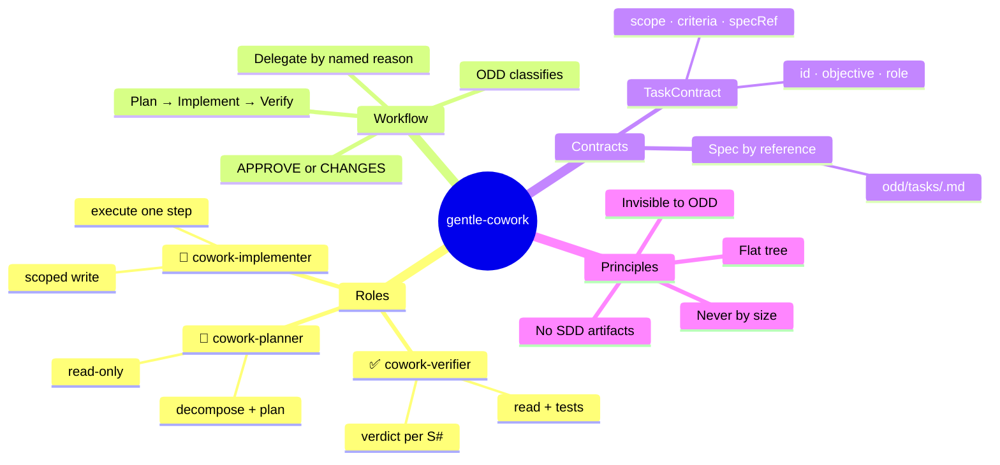

# gentle-cowork

An orchestration extension for [Pi](https://pi.dev) / gentle-shell that turns ODD-approved delegation into a structured, verified, multi-role workflow — without ever becoming a silent SDD.

## Mental Map



## What it does

`gentle-cowork` adds three specialized subagent roles on top of gentle-shell's existing delegation mechanism:

| Role | Permission | Responsibility |
|---|---|---|
| `cowork-planner` | read-only | Decompose the objective into a plan with scope and acceptance criteria |
| `cowork-implementer` | scoped write | Execute one plan step; produces an artifact summary |
| `cowork-verifier` | read + tests | Validate changes per ODD spec requirement (S#); emit `APPROVE` or `CHANGES` verdict |

**The intelligence stays agent-side.** The bridge/extension only routes — every menu action or delegation sends a pre-crafted prompt to the assistant, which uses its native tools.

## Design principles (from the paper)

1. **Delegate by named reason, never by size.** Activated when ODD already determined that delegation has a valid reason (real parallelism, independent verification, context backstop) — never because a task "looks big".
2. **Pass the spec by reference.** Subagents receive the path to the ODD feature document, never a paraphrased summary (per gentle-shell PR #1718).
3. **Lightweight task contract, not SDD artifacts.** Each delegation carries a `TaskContract` (`{ id, objective, role, scope, acceptanceCriteria, specRef, artifacts, status }`) — no formal proposal/spec/design documents.
4. **Flat delegation tree.** Subagents never spawn sub-subagents.
5. **Invisible to ODD.** The user describes what they need; the extension routes naturally. No `/cowork` invocation required for normal flows.

## Architecture

```
Pi / gentle-shell (ODD orchestrator)
  └── gentle-cowork extension (this repo)
        ├── tool_call hook — detects delegation triggers
        ├── TaskContract — lightweight orchestration data
        └── subagent spawn (pi --mode rpc)
              ├── cowork-planner (read)
              ├── cowork-implementer (scoped write)
              └── cowork-verifier (read + tests)
```

## Installation

```bash
# From the repo root
pi -e ./src/gentle-cowork.ts
```

Or add to your agent directory extensions folder:

```bash
cp src/gentle-cowork.ts ~/.pi/agent/extensions/gentle-cowork.ts
```

## Usage

The extension registers `/cowork` as a manual trigger. For automatic delegation, the `tool_call` hook detects when gentle-shell is about to delegate and applies the role orchestration based on the named delegation reason.

## Contributing

Contributions follow the gentle-ecosystem contracts — the full rules live in [`.github/CONTRIBUTING.md`](.github/CONTRIBUTING.md):

- **Linear-first:** work is tracked in Linear (team `BLA`, project *gentle-cowork*); every PR references its issue as `BLA-N`, and evidence-first GitHub issue templates are the entry point for community reports.
- **Branch model:** `main` is the protected stable branch; feature branches (`feat|fix/<linear-issue>-<short>`) are cut from `dev`, and PRs target `dev`. Releases flow `dev` → `main` through an automated release PR.
- **Conventional Commits** in work-unit slices (~400 authored lines), with chained PRs for anything larger. The suite (`npx vitest run`) must be green and `npx tsc --noEmit` clean — strict TypeScript, no `any` ever — before every PR.

## Versioning

This project follows [Semantic Versioning](https://semver.org/spec/v2.0.0/). Versions are automated by [release-please](https://github.com/googleapis/release-please) from Conventional Commits: `feat` → minor, `fix` → patch, breaking changes (`!` / `BREAKING CHANGE:` footer) → major, and `docs`/`chore` never trigger a release. Human-readable history lives in [`CHANGELOG.md`](CHANGELOG.md).

## License

MIT
