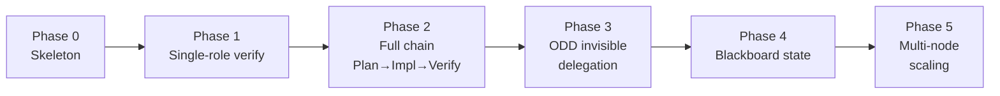

# gentle-cowork — ROADMAP

> Phased implementation plan. Each phase is independently testable and ODD-compliant.

## Phase 0 — Skeleton (current)

- [x] Project structure (README, ROADMAP, src/, agents/, skills/)
- [x] TaskContract type definition (src/types.ts)
- [x] Extension entry point with `/cowork` command (src/gentle-cowork.ts)
- [x] Agent definitions: planner, implementer, verifier (agents/)
- [x] SKILL.md for the gentle-ai skill system

**Exit criteria:** `pi -e ./src/gentle-cowork.ts` loads without errors; `/cowork` prints status; TaskContract type compiles.

## Phase 1 — Single-role verification

- [x] Spawn a `cowork-verifier` subagent (`pi --mode rpc`) with a test prompt
- [x] Receive the verifier's verdict (APPROVE/CHANGES)
- [x] Log the verdict to the launcher log

**Exit criteria:** A verifier subagent runs, reads a test file, and returns a structured verdict.

## Phase 2 — Planner → Implementer → Verifier chain

- [x] `cowork-planner` receives an objective, returns a plan (list of steps with scope + criteria)
- [x] `cowork-implementer` receives one step, executes it, returns an artifact summary
- [x] `cowork-verifier` receives the artifact, runs tests, returns a per-S# verdict
- [x] If verdict is `CHANGES`, loop back to implementer (max 3 retries)

**Exit criteria:** A complete plan → implement → verify cycle runs without manual intervention.

## Phase 3 — ODD integration (invisible delegation)

- [x] Hook into `tool_call` — detect when gentle-shell is about to delegate (tool names containing "delegate" or "subagent")
- [x] When detected and a named reason exists → apply role orchestration instead of native delegation
- [x] When no reason exists → let native delegation proceed (do NOT intercept)
- [x] The user should never need to invoke `/cowork` explicitly

**Exit criteria:** Delegation happens naturally; the user describes what they need and the orchestration is invisible.

## Phase 4 — Blackboard state (shared orchestration state)

- [x] A shared state file (JSON) that all roles read/write
- [x] TaskContract persistence (pending → in_progress → completed/failed)
- [x] Survives daemon restart (state file on disk)

**Exit criteria:** A delegation can be interrupted and resumed without losing the contract state.

## Phase 5 — Multi-node scaling (future)

- [ ] Master/Worker architecture: gentle-shell on a VPS as orchestrator, gentle-cowork agents on distributed workers
- [ ] WebSocket or gRPC communication layer
- [ ] Zero-Trust security (TLS, per-role permissions, allowlisted workers)
- [ ] Horizontal scaling: add workers by deploying new gentle-shell instances

**Exit criteria:** Two nodes communicating; a task delegated to a remote worker completes and returns a verdict.

---

## Non-goals

- No sprints, no SDD artifacts, no formal proposal/spec/design documents
- No auto-activation by file count (delegation by reason only)
- No sub-subagent spawning (flat tree)
- No replacement of the gentle-ai review authority (verifier invokes it, never replaces it)
